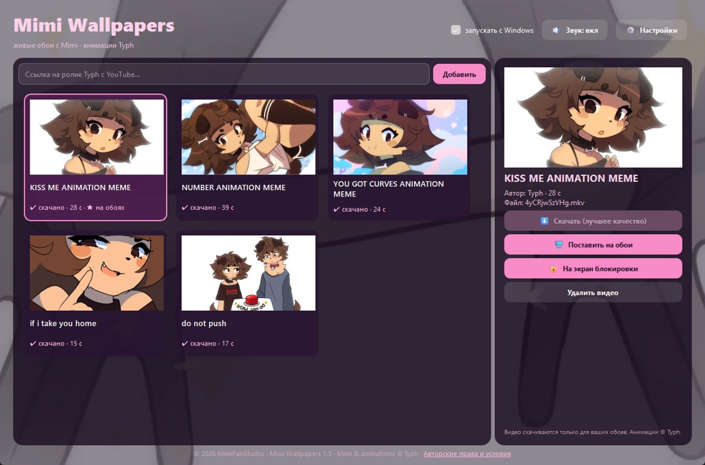
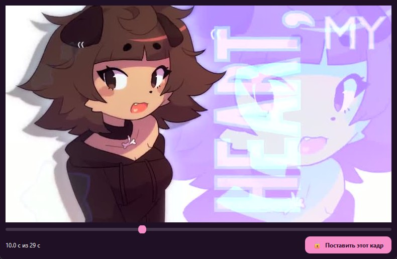
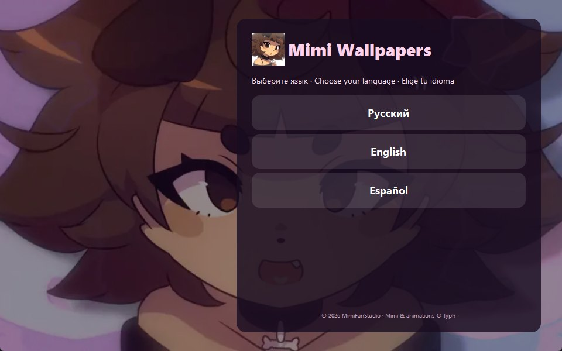

# Mimi Wallpapers

[English](README.md) · [Русский](README.ru.md) · **Español**

Fondos de escritorio animados con **Mimi**, el personaje de las animaciones de **[Typh](https://www.youtube.com/@crispytyph)**.
Proyecto de fans gratuito y sin ánimo de lucro de **MimiFanStudio**.

> **Las imágenes de Mimi y el video incluido se usan con permiso de Typh.** Mimi y todas las animaciones © Typh.
> La aplicación descarga videos del canal oficial de YouTube de Typh en tu equipo **solo para usarlos como fondo personal**.
> Apoya al creador: mira sus videos y dales “me gusta” en YouTube.

## Capturas
| Lanzador | Fotograma para la pantalla de bloqueo | Instalador |
|---|---|---|
|  |  |  |

## Funciones
- **Catálogo de animaciones de Typh**: los títulos y las miniaturas vienen directamente de YouTube.
- **Solo el canal de Typh**: puedes añadir videos nuevos por enlace, pero solo del canal de Typh. La aplicación comprueba el ID del canal.
- **Descarga en máxima calidad**: hasta 4K a 60 fps con sonido, con [yt-dlp](https://github.com/yt-dlp/yt-dlp). La barra de progreso nunca retrocede.
- **Sin créditos largos**: los créditos del final del video se recortan automáticamente tras la descarga, sin pérdida de calidad.
- **Motor de fondos propio**: un clic pone el video en el escritorio bajo los iconos, en bucle y con decodificación por hardware (basado en [mpv](https://mpv.io)). No hace falta Lively Wallpaper ni otras apps de fondos.
  - fondo en cada monitor;
  - se pausa mientras hay un juego o video a pantalla completa, para no gastar la GPU;
  - cambia de video sin parpadeos y vuelve solo si se reinicia el Explorador.
- **Pantalla de bloqueo**: eliges un fotograma con un deslizador y se aplica en resolución completa, sin permisos de administrador.
- **Sonido sí/no** y volumen del fondo. Por defecto solo suena en el escritorio vacío; activa **«Sonido en todas partes»** en Ajustes para oírlo en cualquier ventana o pestaña.
- **Iniciar con Windows**: tu último fondo vuelve tras reiniciar.
- **Idiomas**: Español, English, Русский.
- **Instalador con Mimi**: un fondo animado con Mimi desde el primer segundo, con condiciones de uso. El primer fondo (KISS ME) ya viene dentro del instalador: funciona al instante, incluso sin VPN. Instala por usuario (sin permisos de administrador) y obtiene las herramientas que falten con `winget`. Se desinstala desde *Aplicaciones*.

## Instalación
1. Descarga `MimiWallpapers_Setup_public.exe` desde [Releases](../../releases).
2. Ejecútalo, elige el idioma, acepta las condiciones y pulsa **Instalar**.
   Si hace falta, el instalador añade mpv, yt-dlp y FFmpeg desde el catálogo oficial `winget` de Windows.
3. Abre **Mimi Wallpapers**, elige un video y pulsa **Descargar** → **Poner de fondo**.

Requisitos: Windows 10/11 x64 y conexión a internet.

> ⚠️ **Los videos se descargan de YouTube.** Si YouTube está bloqueado o ralentizado en tu país, los fondos **no se descargarán sin una VPN** (u otra forma de acceder a YouTube). Los fondos ya descargados siguen funcionando sin conexión.

## Compilar desde el código
```powershell
python -m venv .venv
.venv\Scripts\pip install PySide6-Essentials pyinstaller pywinauto pillow
powershell -ExecutionPolicy Bypass -File build.ps1 -Public
```
El instalador queda en `installer\MimiWallpapers_Setup_public.exe`.

El diseño con Mimi (`launcher_bg.mp4`, `setup_bg.webp`, `mimi.ico`, `mimi.png`) está en el repositorio y se usa con permiso de Typh. El primer video del catálogo se incluye en el instalador si ya está descargado en `%LOCALAPPDATA%\MimiWallpapers\videos`.

## Estructura
| Ruta | Qué es |
|---|---|
| `launcher/mimi_launcher.py` | el lanzador (Python + PySide6) |
| `launcher/engine.py` | el motor de fondos (funciona en segundo plano como `MimiWallpapers.exe --engine`) |
| `launcher/setup.py` | el instalador |
| `launcher/common.py` | rutas comunes, estilo, fondo animado |
| `launcher/i18n.py` | traducciones, condiciones de uso, ID del canal de Typh |
| `catalog.json` | catálogo de videos (ID de YouTube y títulos) |
| `launcher_bg.mp4`, `setup_bg.webp`, `mimi.ico`, `mimi.png` | diseño con Mimi (con permiso de Typh) |
| `docs/` | capturas |
| `tools/make_public_assets.py` | genera gráficos de reserva al compilar |
| `tests/` | pruebas de interfaz (pywinauto): lanzador, instalación, desinstalación |
| `build.ps1` | script de compilación |

## Pruebas
```powershell
.venv\Scripts\python tests\ui_test_launcher.py   # 14 comprobaciones
.venv\Scripts\python tests\ui_test_setup.py      # 17 comprobaciones
.venv\Scripts\python tests\ui_test_sound.py      # 5 comprobaciones
.venv\Scripts\python tests\test_engine.py         # 15 comprobaciones: motor
```

## Condiciones y licencia
- [Condiciones de uso](TERMS.md#español) (también se muestran en el instalador y en la aplicación).
- Código fuente: [MIT](LICENSE) © 2026 MimiFanStudio.
- Mimi y las animaciones: © Typh, usados con permiso. La licencia MIT no se aplica a ellos.
- Software de terceros: mpv (GPL-2.0+), yt-dlp (Unlicense), FFmpeg (LGPL/GPL), Qt for Python / PySide6 (LGPL-3.0).
